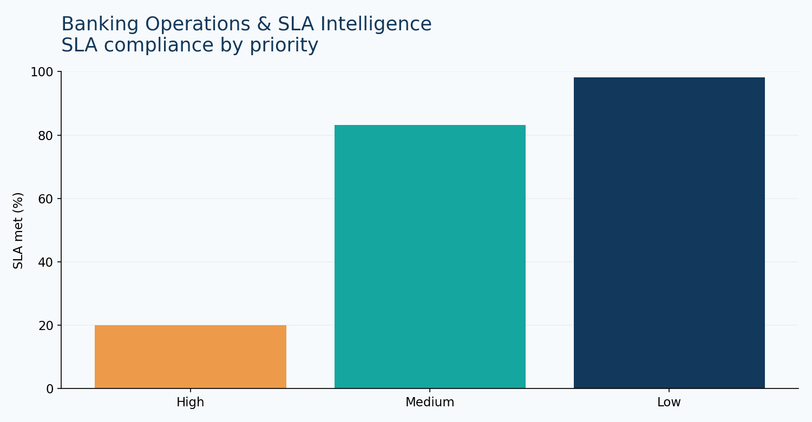

# Banking Operations & SLA Intelligence

Operational SLA compliance, transaction processing and exception reporting.

## Problem and analysis

**Business question:** Which operational queues are missing service-level targets, and where should managers focus?

**KPIs:** total cases, SLA compliance %, mean resolution hours, performance by priority/channel.

**Recommendation framework:** prioritize high-priority queues with low compliance; review staffing and routing before changing targets.

**Limitations:** synthetic durations and priority-based SLA thresholds; no real banking data.

## Reproduce

From repository root: `pip install -r requirements.txt` then `streamlit run app.py`. Select **Banking Operations** (or its corresponding sidebar project).

## Data dictionary

Data is **synthetic and generated for demonstration**. See `data/*.csv` for reproducible sample records.

## BA value

Connects metrics to operational decisions, documenting assumptions and constraints.
