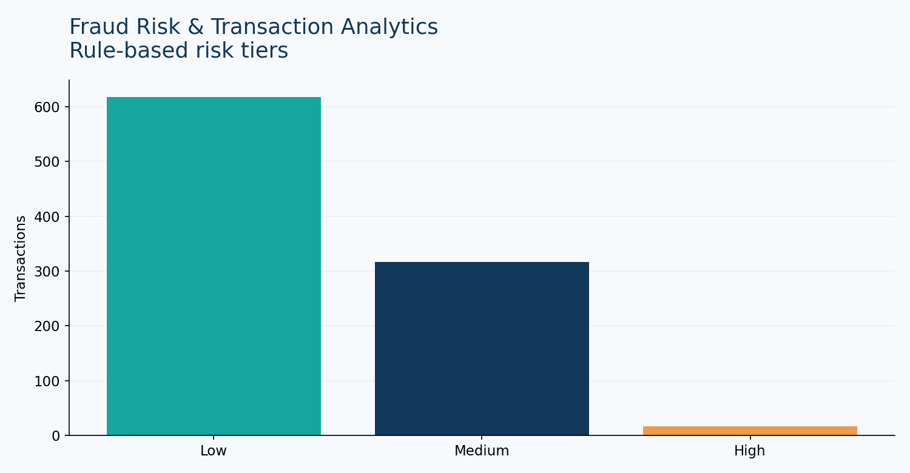

# Fraud Risk & Transaction Analytics

Transparent rule-based risk scoring and investigation prioritization.

## Problem and analysis

**Business question:** Which transactions should an analyst investigate first using transparent rules?

**KPIs:** high-risk count, flagged transaction value, tier distribution and top-risk transactions.

**Rules:** amount >$2,000 (+30), international (+20), new payee (+20), 5+ transactions in 24h (+20), 00:00–05:59 (+10). High tier ≥50.

**Limitations:** heuristic scores, no fraud outcome labels; never treat flagged transactions as proven fraud.

## Reproduce

From repository root: `pip install -r requirements.txt` then `streamlit run app.py`. Select **Fraud Risk** (or its corresponding sidebar project).

## Data dictionary

Data is **synthetic and generated for demonstration**. See `data/*.csv` for reproducible sample records.

## BA value

Connects metrics to operational decisions, documenting assumptions and constraints.
