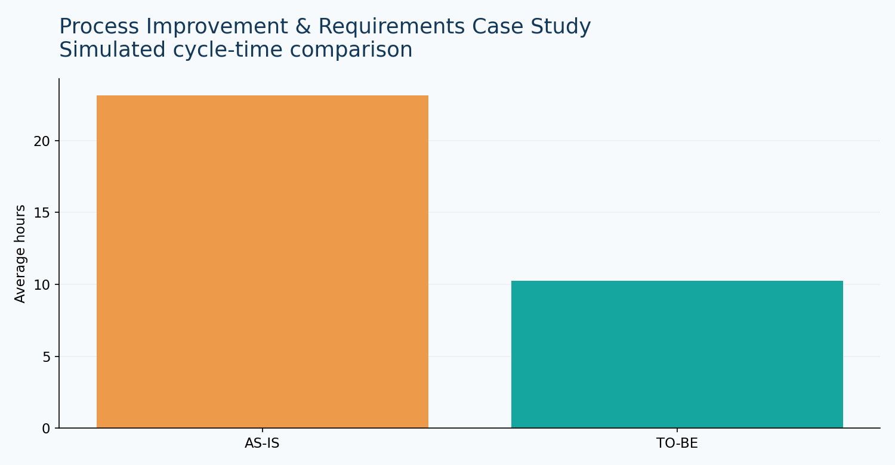

# Process Improvement & Requirements Case Study

AS-IS / TO-BE workflow, requirements traceability and measurable cycle-time savings.

## Problem and analysis

**Business question:** How might redesigned request routing reduce turnaround time?

**KPIs:** mean AS-IS time, modeled TO-BE time, modeled reduction %.

**Deliverables:** AS-IS / TO-BE steps, user stories, acceptance criteria, traceability matrix and UAT scenarios in docs/.

**Limitations:** TO-BE results are simulated assumptions, not measured outcomes.

## Reproduce

From repository root: `pip install -r requirements.txt` then `streamlit run app.py`. Select **Process Improvement** (or its corresponding sidebar project).

## Data dictionary

Data is **synthetic and generated for demonstration**. See `data/*.csv` for reproducible sample records.

## BA value

Connects metrics to operational decisions, documenting assumptions and constraints.
