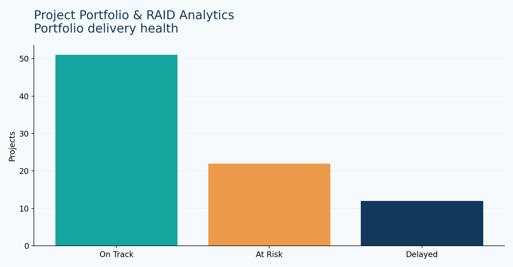

# Project Portfolio & RAID Analytics

Portfolio health, budget variance, milestone delays and risk management.

## Problem and analysis

**Business question:** Which projects need intervention based on delivery, cost and risk?

**KPIs:** project count, at-risk/delayed count, budget variance, high-risk exposure by workstream.

**Recommendations:** escalate high-risk delayed workstreams; investigate unfavorable variances and overdue milestones.

**Limitations:** synthetic portfolio, no real company financials or project information.

## Reproduce

From repository root: `pip install -r requirements.txt` then `streamlit run app.py`. Select **Project Portfolio** (or its corresponding sidebar project).

## Data dictionary

Data is **synthetic and generated for demonstration**. See `data/*.csv` for reproducible sample records.

## BA value

Connects metrics to operational decisions, documenting assumptions and constraints.
