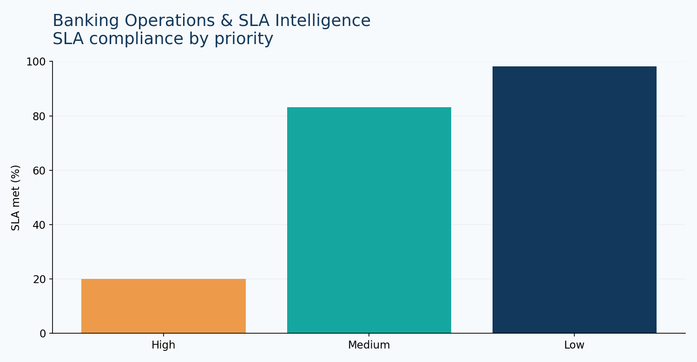
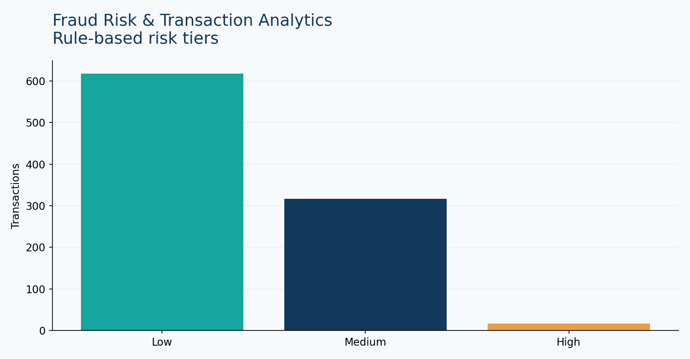
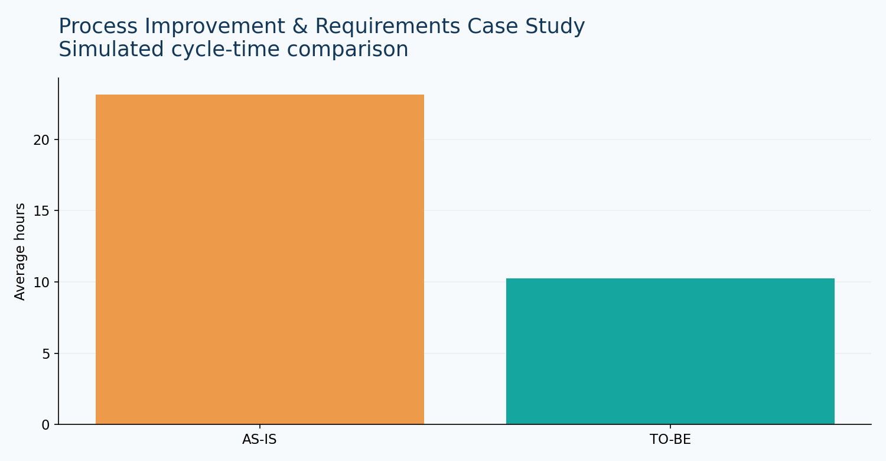
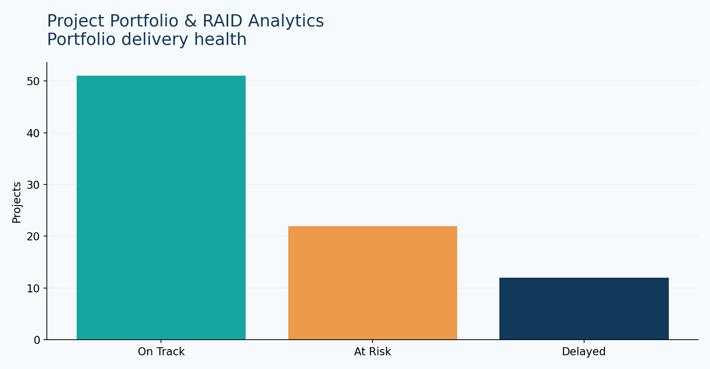

# Business Analyst Portfolio | Operations • Banking • Analytics

> Four practical, recruiter-friendly case studies built with Python, pandas, Streamlit, and synthetic datasets. **Not real client or employer work.**

## Explore the projects

| Project | Business question | Deliverables |
|---|---|---|
| [01 · Banking Operations](01-banking-operations/) | Are teams meeting SLAs? | KPI dashboard, synthetic cases, KPI dictionary |
| [02 · Fraud Analytics](02-fraud-analytics/) | Which transactions merit review? | Explainable scoring, risk tiers, transaction explorer |
| [03 · Process Improvement](03-process-improvement/) | How can intake turnaround improve? | AS-IS / TO-BE, requirements, traceability, UAT |
| [04 · Project Portfolio](04-project-portfolio/) | Which projects need intervention? | Portfolio dashboard, RAID example, budget variance |

## Dashboard previews

| Banking operations | Fraud risk |
|---|---|
|  |  |
| Process improvement | Project portfolio |
|  |  |

## Run locally

```bash
python -m venv .venv
# Windows: .venv\Scripts\activate
# macOS/Linux: source .venv/bin/activate
pip install -r requirements.txt
streamlit run app.py
```

Use the sidebar to switch between four interactive dashboards.

## Validate the calculations

```bash
pytest -q
```

## Skills demonstrated

Business analysis · KPI definition · SLA monitoring · Process mapping · Requirements traceability · UAT scenarios · RAID tracking · Risk prioritization · Python · pandas · Streamlit · Data visualization

## Data ethics and scope

All records are **synthetic** and generated solely for demonstration. No real customer, transaction, employee, or employer data is included. Charts are based on the sample CSVs. The dashboards are interactive Streamlit implementations; the preview PNGs are static chart previews, not screenshots of a deployed site. Fraud flags are not verified fraud. Process improvements are modeled, not observed.

## Publishing

1. Create a GitHub account at https://github.com/signup (if needed).
2. Create a public repository called `business-analyst-portfolio`.
3. Upload **the contents of this folder** (not the ZIP itself) via **Add file → Upload files**, or use Git commands below.
4. Set the repository description to: `Business analysis case studies: banking operations, fraud analytics, process improvement, and project portfolio reporting.`
5. Pin the repository on your GitHub profile.

```bash
git init
git add .
git commit -m "Add four business analyst case studies"
git branch -M main
git remote add origin https://github.com/YOUR_USERNAME/business-analyst-portfolio.git
git push -u origin main
```

Do not claim these are professional client deliverables. Present them as independent portfolio demonstrations.
